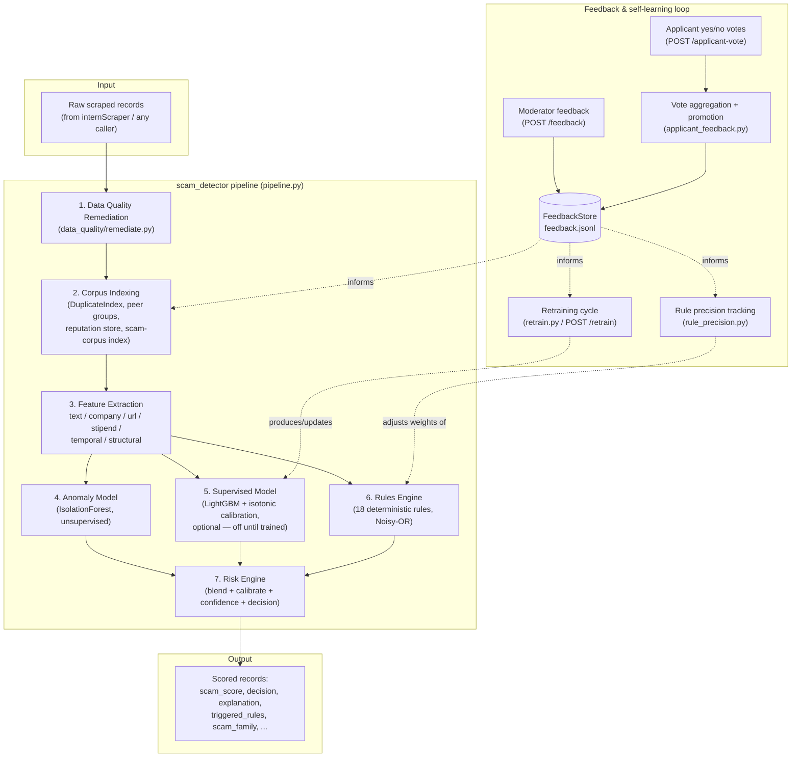
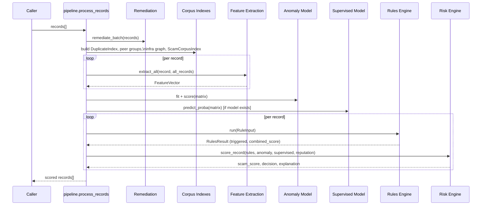
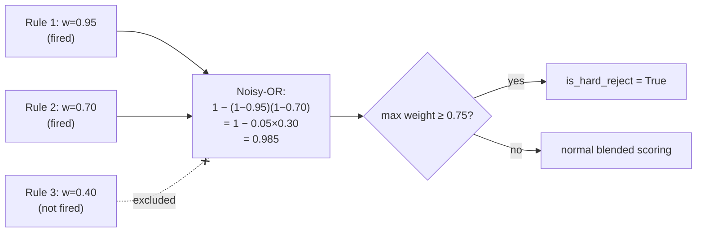
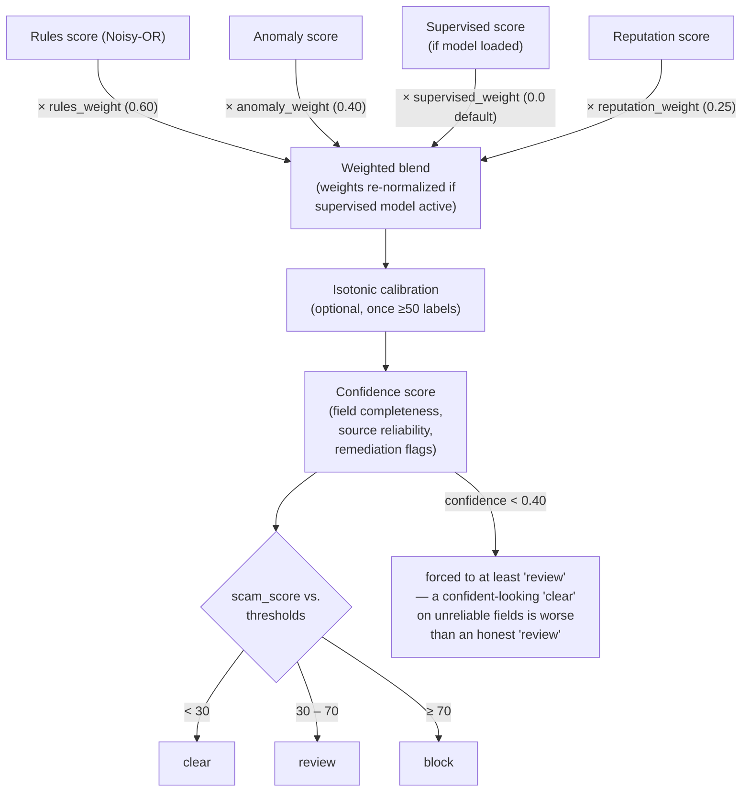
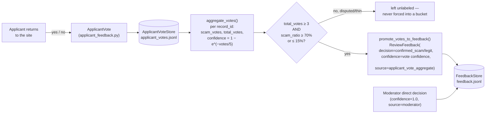
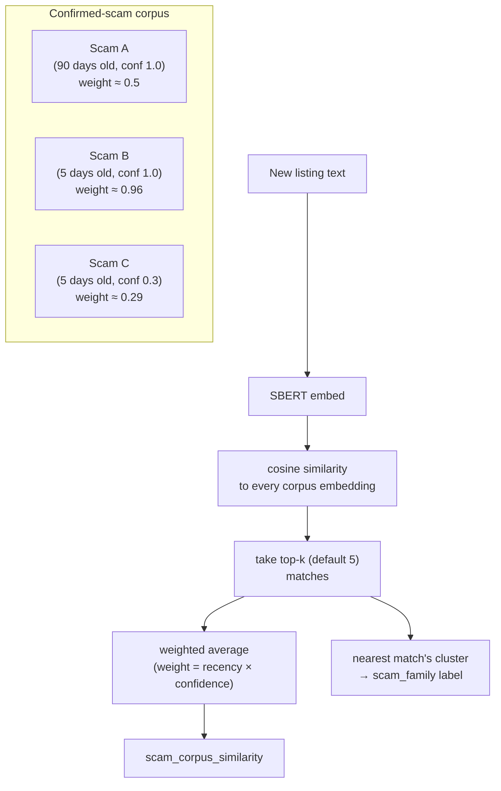
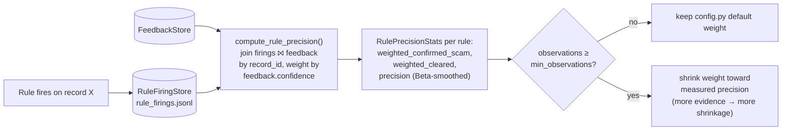
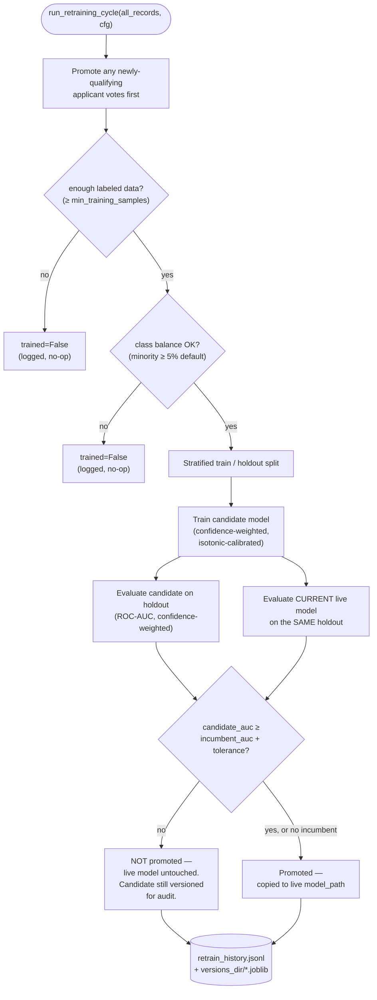

# iFind Scam Detector — Full System Reference

A multi-stage fraud-detection engine for internship listings: deterministic
rules, unsupervised anomaly detection, an optional supervised classifier,
and a human/applicant feedback loop that lets the whole system improve
itself over time. This document covers every stage end to end — theory,
architecture, data flow, every rule and weight, the feedback/learning
system, the API surface, and what's deliberately not built yet.

> Scope note: this README documents `scam_detector/` as it exists in this
> repository. It is a library + FastAPI service that *scores* records
> handed to it — it does not scrape, store, or serve a frontend itself.

---

## Table of contents

1. [Why this exists](#1-why-this-exists)
2. [High-level architecture](#2-high-level-architecture)
3. [Pipeline walkthrough](#3-pipeline-walkthrough)
4. [Data quality remediation](#4-data-quality-remediation)
5. [Feature extraction](#5-feature-extraction)
6. [The rules engine (Noisy-OR)](#6-the-rules-engine-noisy-or)
7. [The anomaly model (IsolationForest)](#7-the-anomaly-model-isolationforest)
8. [Risk engine: blending, calibration, decisions](#8-risk-engine-blending-calibration-decisions)
9. [The feedback & self-learning system](#9-the-feedback--self-learning-system)
10. [Automated retraining ("self-learning") pipeline](#10-automated-retraining-self-learning-pipeline)
11. [API reference](#11-api-reference)
12. [Configuration reference](#12-configuration-reference)
13. [Testing & validation philosophy](#13-testing--validation-philosophy)
14. [Known limitations & deliberately deferred work](#14-known-limitations--deliberately-deferred-work)
15. [File map](#15-file-map)

---

## 1. Why this exists

Internship listing platforms get flooded with fraudulent postings:
upfront "registration fee" scams, fake training programs disguised as
internships, data-harvesting forms, typosquatted company domains, and
coordinated shell-company networks reusing the same infrastructure.
Scrapers can't tell real from fake — they just copy whatever text is on
the page. This engine sits between the scraper and the end user and
assigns every listing a `scam_score` (0–100), a `decision`
(`clear` / `review` / `block`), and a human-readable explanation.

Three design principles run through the whole system:

- **Explainability over magic.** Every score traces back to specific,
  named triggered rules or features — never an opaque black-box number
  a moderator can't audit.
- **Never trust a single weak signal.** Everything — a WHOIS lookup, a
  user report, an ML prediction — is gated behind thresholds, confidence
  weighting, or minimum-volume requirements before it can move a score
  meaningfully. See [§9](#9-the-feedback--self-learning-system).
- **Inert-until-proven, not inert-forever.** Several subsystems
  (reputation tracking, scam-family clustering, the supervised
  classifier, adaptive rule weights) are genuine no-ops on a fresh
  deployment with no history — that's by design, not a bug — and
  activate automatically once enough real data accumulates.

---

## 2. High-level architecture



---

## 3. Pipeline walkthrough

Every call to `pipeline.process_records(records, config=cfg)` runs the
following, in order, for the whole batch:

1. **Remediate** every raw record (fix known scraper data-quality bugs —
   see [§4](#4-data-quality-remediation)).
2. **Promote** any applicant votes that have crossed the promotion
   threshold into the feedback store (so this run sees the freshest
   labels — see [§9](#9-the-feedback--self-learning-system)).
3. **Build corpus-wide structures once** for the whole batch: a
   `DuplicateIndex` (SBERT near-duplicate detection), peer groups (for
   stipend/openings z-scores), a company-infrastructure graph (shared
   domains/IPs), an NGO lump-sum stipend index, and the weighted/
   clustered `ScamCorpusIndex` from confirmed-scam feedback.
4. **Extract features** per record across six categories (text, company,
   URL, stipend, temporal, structural).
5. **Score with the anomaly model** (unsupervised, batch-fit per run).
6. **Score with the supervised model**, if a trained artifact exists
   (off by default — see [§9.5](#95-confidence-weighted-supervised-classifier)).
7. **Run the rules engine** per record, using a config whose rule weights
   may have been live-adjusted from feedback-measured precision (see
   [§9.4](#94-adaptive-rule-weights-from-live-precision)) — and log which
   rules fired for later precision tracking.
8. **Blend everything in the risk engine**, calibrate, compute confidence,
   and apply decision thresholds.
9. **Update** the reputation store and per-source completeness baselines
   for the next run.



---

## 4. Data quality remediation

Scrapers produce systematically flawed data — this stage fixes known
patterns *before* any scoring happens, so downstream signals aren't
corrupted by scraper bugs masquerading as fraud signals:

| Issue | Fix |
|---|---|
| `company` field leaks a category/skill name instead of a real company | Flagged as `company_is_suspect` — identity-based rules (typosquat, reputation) skip it rather than treating junk as a real brand |
| `degree` defaults to `M.Tech`/`B.Tech` for non-engineering roles | Flagged, not trusted as a real requirement signal |
| `deadlineDate` almost always null | Treated as *unknown*, never as "no urgency" |
| Summary hard-truncated by the scraper | Flagged `summary_truncated` so readability/grammar scoring doesn't penalize a cut-off sentence as poor writing |
| `openings` defaulted to a filler value | Flagged so structural z-scores don't treat a scraper default as a real anomaly |
| Mislabeled company (identical to title, or title plus a trailing year) | Flagged via `flag_mislabeled_company` |

---

## 5. Feature extraction

Six independent extractors, each pure and individually testable, feed a
single `RuleInput` / feature matrix:

| Category | Module | Examples |
|---|---|---|
| **Text** | `features/text_features.py` | urgency language, genericity of title, caps/punctuation abuse, sensitive-info requests, guaranteed-outcome claims, external-form/phone handoff, training-disguised-as-internship, **scam-corpus similarity** (§9.3), readability/grammar |
| **Company** | `features/company_features.py`, `reputation_features.py` | typosquat distance to known brands, domain age (WHOIS, gated to genuine off-platform employer links only), **reputation score** (§9.2) |
| **URL** | `features/url_features.py` | platform-internal vs. off-platform, URL shorteners, known-ATS detection, domain-company name similarity |
| **Stipend** | `features/stipend_features.py` | normalized hourly-INR stipend, peer-group z-score, stipend/perk contradiction checks |
| **Temporal** | `features/temporal_features.py` | posting burst detection, deadline urgency |
| **Structural** | `features/structural_features.py` | openings z-score, field completeness |

Cross-record structures (built once per batch, not per record):
`DuplicateIndex` (SBERT near-duplicate detection across companies),
company-infrastructure graph (shared domains/IPs → shell-company
networks), and the NGO/fundraising lump-sum stipend network index.

---

## 6. The rules engine (Noisy-OR)

Fast, cheap, fully explainable deterministic rules run *before* any
statistical layer. Each rule independently returns a weight in `[0, 1]`
if triggered; all triggered weights combine via **Noisy-OR**:

```
combined_score = 1 − ∏ (1 − wᵢ)   over all triggered rule weights wᵢ
```

This avoids double-counting (simple summation would blow past 1.0
instantly) while still letting several moderate signals compound into a
high score together. Any single rule firing at weight ≥ **0.75**
(`_HARD_REJECT_WEIGHT_THRESHOLD`) forces `is_hard_reject = True`,
escalating to review/block regardless of everything else.



### All 18 rules, by weight

| Rule | Weight | Why |
|---|---|---|
| `upfront_fee_and_pay_to_work` | 0.90 | Explicit "pay to work" / registration-fee demand |
| `hard_disqualifying_signals` | 0.95 | Bank/Aadhaar/PAN/deposit requests — near-automatic escalation |
| `guaranteed_outcome_claim` | 0.85 | "100% guaranteed placement", "no interview needed" — real internships never promise this |
| `cross_company_duplicate` | 0.80 | Identical posting text reused under different company names — same script, multiple shells |
| `similar_to_confirmed_scam` | 0.70 | SBERT similarity to the weighted, clustered confirmed-scam corpus (§9.3) |
| `typosquat_domain` | 0.70 | Off-platform apply link's domain barely resembles the claimed company name |
| `training_program_disguised_as_internship` | 0.65 | Positioned as a paid "certification/training program," not a real internship |
| `shared_infrastructure` | 0.65 | Multiple distinct companies resolve to the same domain/IP infrastructure |
| `ngo_fundraising_stipend_network` | 0.65 | Coordinated identical lump-sum stipend across an NGO/fundraising-sector network |
| `external_form_handoff` | 0.60 | Off-platform form / personal WhatsApp-style phone handoff |
| `young_domain_age` | 0.55 | Off-platform employer domain registered < 90 days ago (only evaluated for genuine off-platform links, never platform/ATS) |
| `zero_shot_semantic_scam_signal` | 0.55 | Optional pretrained zero-shot classifier (⚠️ disabled by default — unreliable, see [§14](#14-known-limitations--deliberately-deferred-work)) |
| `suspicious_recruiter_contact` | 0.50 | Recruiter email domain inconsistent with claimed company |
| `extreme_stipend_outlier` | 0.45 | `\|z-score\| > 3.0` vs. peer group, either direction |
| `urgency_psychological_pressure` | 0.45 | Manipulation language + high urgency score together |
| `mass_openings_vague_role` | 0.40 | Abnormally high openings count *and* a generic job title together |
| `stipend_perk_contradiction` | 0.35 | Text claims contradict the structured stipend/perk fields |
| `unverifiable_company` | 0.10 | Scraper category-leak flag — reduces *confidence*, not fraud score directly |

All weights and thresholds live in `config.py` (`RuleWeights`,
`RuleThresholds`) — tunable without touching any rule's logic.

---

## 7. The anomaly model (IsolationForest)

An unsupervised `sklearn.ensemble.IsolationForest` fits fresh on every
batch's numeric feature matrix (`scoring/anomaly_model.py`,
`assemble_feature_matrix`). It needs no labels at all — it just learns
what "normal" looks like for *this batch* and flags statistical
outliers. Explanations come from either exact SHAP TreeExplainer values
(`enable_shap_anomaly_explanations`) or a z-score approximation fallback.

This is why the system has *some* signal from day one, before any
feedback exists: rules are hand-authored and the anomaly model needs
zero history, while reputation, scam-family clustering, the supervised
model, and adaptive rule weights all require real accumulated feedback
first (deliberately, see [§9](#9-the-feedback--self-learning-system)).

---

## 8. Risk engine: blending, calibration, decisions

`scoring/risk_engine.py` combines every signal into one 0–100
`scam_score`:



- **Decision thresholds** (`DecisionThresholds`): `clear_below=30`,
  `block_at_or_above=70`; `30–70` is `review`.
- **Confidence bands** (`ConfidenceConfig`): confidence `< 0.40` forces at
  least `review` regardless of score — a low-confidence "clear" is more
  dangerous than an honest "review," since it means the fields the score
  relied on may themselves be unreliable (sparse/truncated scraper data).
- **Hard reject** always escalates regardless of the blended score.
- Every result carries `triggered_rules`, `top_contributing_features`,
  and a `risk_breakdown` of each component's contribution — nothing is a
  black box.

---

## 9. The feedback & self-learning system

This is the heart of the session's work: a loop that lets the system get
better at catching scams over time, built around the **real** shape of
the only feedback that actually exists in production — not an idealized
one.

### 9.0 The feedback signal, honestly

The only question ever asked of a real user is binary and post-hoc:
**"Was this internship a scam? yes / no"** — asked when they return to
the site, if they ever do. That signal is:

- **Delayed** — arrives long after the listing was originally scored.
- **Sparse** — most listings get zero responses, ever.
- **Selection-biased** — people who feel scammed are far more motivated
  to answer than people who had an unremarkable, legitimate experience.
- **Noisy** — one applicant's personal read, not an informed review; a
  real scam that paid out a small stipend before vanishing might get
  marked "no," and "the company never responded" (common and often
  innocent) might get marked "yes."

Every mechanism below treats this as **weak supervision** — never as
ground truth — and is built so that a single report can never, by
itself, flip a decision, ruin a company's reputation, or move a model.



### 9.1 Weak-label ingestion (`applicant_feedback.py`)

- `ApplicantVote` / `ApplicantVoteStore` — append-only JSONL store of raw,
  per-applicant votes.
- `VoteAggregate.confidence` — grows with vote volume, diminishing
  returns past ~10 votes (`1 vote → 0.18`, `5 votes → 0.63`,
  `10 votes → 0.86`, `20 votes → 0.98`). A lone report simply cannot
  carry the weight of ten agreeing ones.
- `promote_votes_to_feedback()` — only promotes a record once it clears
  **both** a minimum vote count (default 3) **and** a clear majority
  (≥70% scam, or ≤15% scam for the legit side); anything in between is
  left genuinely unlabeled rather than forced into a bucket. Idempotent
  and never overwrites an existing moderator decision.
- `ReviewFeedback` gained `confidence` (1.0 for moderator, fractional for
  promoted votes) and `source` fields so every downstream consumer can
  weight a label by how much it should be trusted.

### 9.2 Confidence-weighted company reputation

`company_reputation_score()` (`reputation_features.py`): a **direct
moderator** `confirmed_scam` still flips a company straight to `1.0`
risk, as before. A **promoted applicant-vote** `confirmed_scam` instead
raises the company's reputation floor *proportionally to its
confidence* — a thin, barely-promoted vote set nudges suspicion up
without being able to single-handedly condemn a real company.

### 9.3 Weighted, decaying, clustered scam-corpus similarity

Previously: one flat embeddings matrix, similarity = single max-match
against it. Now (`text_features.py`, `ScamCorpusIndex`):

- Every confirmed-scam embedding carries a **weight** =
  `recency_decay(half_life=90 days) × feedback_confidence` — old or
  low-confidence reports fade out, so scam-tactic drift over time is
  tracked automatically rather than treating a report from a year ago as
  equal to one from yesterday.
- `scam_corpus_similarity_weighted()` aggregates the **top-k** most
  similar matches, weighted, instead of a single max — a lone
  coincidentally-similar old report can't trigger the rule alone, while
  a cluster of several recent, closely-related reports can.
- Once the corpus has **≥10 confirmed scams**, it's clustered (KMeans)
  into named **scam families** (auto-labeled by over-represented words
  per cluster vs. the whole corpus, e.g. *"Deposit/Registration"*,
  *"Training/Certificate"*) and the nearest family is attached to every
  scored record as `scam_family` — explainability for moderators, not
  just a bare number. Below that threshold, clustering is a no-op by
  design (same pattern as reputation on a fresh deployment).



### 9.4 Adaptive rule weights from live precision

`scoring/rule_precision.py`: every pipeline run logs which rules fired
for which `record_id` (`RuleFiringStore`). Once feedback exists for
those same records, `compute_rule_precision()` joins the two
(confidence-weighted) to measure each rule's **live precision** —
of the times it fired, how often was the record later actually
confirmed a scam vs. cleared or overturned.

`get_adjusted_rule_weights()` shrinks a rule's `config.py` weight toward
its measured precision using Beta-Bernoulli-style smoothing: a rule with
only a handful of feedback-joined firings barely moves; one with
hundreds moves close to its measured precision. Below
`min_firing_observations_for_adjustment` (default 20), a rule's weight
is untouched — same "inert until enough history" pattern as everything
else. **Opt-in** via `flags.enable_adaptive_rule_weights` (default
`False`) until validated on real volume.



### 9.5 Confidence-weighted supervised classifier

`scoring/supervised_model.py` (LightGBM, falling back to sklearn's
`GradientBoostingClassifier`):

- `fit()` now passes each label's `confidence` as a **per-sample
  weight** — a moderator decision counts fully, a promoted applicant-
  vote decision counts proportionally to how much agreement/volume
  backed it.
- Once there are **≥100 rows**, training wraps the base classifier in
  `CalibratedClassifierCV(method="isotonic")` so its output is a genuine
  blendable probability (matching how `reputation_score` and
  `scam_corpus_similarity` are blended), not a raw, miscalibrated
  classifier margin.
- The classifier only ever activates in scoring once
  `blend_weights.supervised_weight` is raised off its `0.0` default and
  a trained artifact exists at `supervised.model_path` — both are
  currently inert, by design, until real feedback volume justifies it.

---

## 10. Automated retraining ("self-learning") pipeline

`retrain.py` is the loop that turns accumulated feedback into an
actually-updated model, with a safety net so a bad retrain can never
silently make production worse.



Key guarantees:

- **Never regresses silently.** The candidate is only promoted if it
  beats (or ties, within a small configurable noise tolerance) the
  *current production model* on the *same* held-out data.
- **Everything is versioned.** Every attempt — promoted or not — is
  saved under `versions_dir` and logged to `retrain_history.jsonl`.
  `list_model_versions()` / `rollback_to_version()` let a promoted model
  be reverted later even if it passed its holdout check but misbehaves
  on real traffic.
- **Nothing calls this automatically yet.** It's a function (and now an
  endpoint — `POST /retrain`) that something else must trigger — a cron
  job, a CI step, or an admin action. No scheduler is wired up in this
  repo.

---

## 11. API reference

FastAPI service (`api.py`). None of the feedback/retraining endpoints
are called by any frontend yet — they exist so a scheduler, admin tool,
or future UI can reach the already-tested backend logic.

| Method | Path | Purpose |
|---|---|---|
| `GET` | `/health` | Liveness, version, component availability (SHAP, etc.) |
| `POST` | `/score` | Score a single internship listing |
| `POST` | `/score/batch` | Batch-score listings with cross-record graph/duplicate detection |
| `POST` | `/graph/analyze` | Company-infrastructure network metrics and coordinated clusters |
| `GET` | `/rules` | List every rule, its current weight, and description |
| `GET` | `/reputation/{company_name}` | A company's current reputation score and history |
| `GET` | `/stats` | System-wide stats |
| `POST` | `/benchmark/sample` | Accuracy/precision/recall/F1 against a labeled sample |
| `POST` | `/feedback` | Record a **moderator** approve/reject decision |
| `GET` | `/feedback/stats` | Progress toward calibration/supervised-model label thresholds |
| `POST` | `/applicant-vote` | Record one **applicant's** post-hoc scam/not_scam report |
| `POST` | `/retrain` | Run one retraining cycle against a supplied record corpus |
| `GET` | `/retrain/history` | Past retraining cycle outcomes (trained/promoted/AUC/versions) |

---

## 12. Configuration reference

Everything is tunable in `config.py` without touching logic:

| Model | Key fields |
|---|---|
| `ScoringWeights` | per-category feature-weight knobs (text/company/url/stipend/temporal/structural) |
| `BlendWeights` | `rules_weight=0.60`, `anomaly_weight=0.40`, `supervised_weight=0.0`, `reputation_weight=0.25` |
| `RuleWeights` | all 18 rule weights — see [§6](#6-the-rules-engine-noisy-or) |
| `RuleThresholds` | numeric thresholds every rule reads (z-score cutoffs, similarity thresholds, min peer-group size, etc.) |
| `DecisionThresholds` | `clear_below=30`, `block_at_or_above=70` |
| `ConfidenceConfig` | `low_below=0.40`, `medium_below=0.70` |
| `SupervisedModelConfig` | `model_path`, `min_training_samples=500`, `versions_dir`, `retrain_history_path`, `holdout_fraction=0.2`, `min_auc_improvement=-0.01`, `min_class_balance=0.05` |
| `CalibrationConfig` | isotonic calibration artifact path, `min_calibration_samples=50` |
| `ReputationConfig` / `FeedbackConfig` | store paths for reputation, moderator feedback, applicant votes, rule-firing log |
| `FeatureFlags` | `enable_adaptive_rule_weights` (off), `enable_shap_anomaly_explanations` (on), `enable_ml_risk_engine` (off), per-category feature toggles |
| `ZeroShotConfig` | ⚠️ marked unreliable — see [§14](#14-known-limitations--deliberately-deferred-work) |
| `EmbeddingConfig` | shared SBERT model name (`all-MiniLM-L6-v2` by default) |

---

## 13. Testing & validation philosophy

Every new signal in this system was validated against **real scraped
data or real embeddings**, not just synthetic examples, before being
trusted — this caught multiple real precision bugs during development
(e.g. a genericity-scoring bug that saturated every title containing the
word "Internship" to maximum genericity; a WHOIS feature that was
computed but silently never consumed by any rule; a sensitive-info
regex that false-matched a common colloquial phrase). The weighted
scam-corpus similarity and clustering logic specifically was tested
against a real, locally-installed SBERT model rather than a mock, to
confirm the actual numeric behavior (recent reports really do outweigh
old ones; low-confidence reports really do count for less).

Current suite: 700+ tests, all passing except two pre-existing,
unrelated failures (SHAP backend availability in this environment, and
one `genericity_score` edge case) that predate this work and are
independently tracked.

---

## 14. Known limitations & deliberately deferred work

These were considered and explicitly **not** built yet, because they
need preconditions this deployment doesn't have:

- **No frontend wires any of this up yet.** `POST /feedback` and
  `POST /applicant-vote` exist and are tested, but nothing in the
  product calls them. Until a moderator UI and an applicant yes/no
  prompt exist, `feedback.jsonl` stays empty and every "inert until
  enough history" subsystem above stays inert.
- **No scheduler triggers `POST /retrain`.** The retraining pipeline
  works correctly when called, but nothing calls it periodically yet.
- **The supervised classifier has no trained artifact.** Training needs
  ≥500 labeled examples by default; there are currently 0 in production.
  `blend_weights.supervised_weight` is `0.0` for the same reason —
  raising it before a model exists would just blend in nothing.
- **SBERT contrastive fine-tuning** on real confirmed-scam/confirmed-legit
  pairs (improving the embedding model itself, not just how its output
  is aggregated) was scoped but deliberately deferred — it needs
  meaningfully more confirmed-scam volume than currently exists to be
  worth the complexity.
- **Active-learning prioritization** (asking the yes/no question
  preferentially on listings the model is least confident about, rather
  than uniformly) was scoped but deferred for the same reason, and
  because it's the one piece that would need to shape actual product/UI
  behavior rather than stay backend-only.
- **The zero-shot semantic scam classifier** (`ZeroShotSemanticScamSignalRule`)
  is implemented but flagged `⚠️ KNOWN UNRELIABLE` in its own config
  docstring — initial validation showed a high false-positive rate
  (~20%) and it should not be re-enabled without fresh validation.

---

## 15. File map

```
scam_detector/
├── pipeline.py                    orchestrates every stage end to end
├── config.py                      every tunable weight/threshold/flag
├── api.py                         FastAPI service + all endpoints
├── feedback.py                    moderator ReviewFeedback + FeedbackStore
├── applicant_feedback.py          weak-label applicant vote aggregation/promotion
├── retrain.py                     automated retraining cycle + versioning/rollback
├── data_quality/
│   └── remediate.py               scraper data-quality fixes (§4)
├── features/
│   ├── text_features.py           text signals + ScamCorpusIndex (§9.3)
│   ├── company_features.py        typosquat, WHOIS domain age
│   ├── reputation_features.py     company reputation store + scoring (§9.2)
│   ├── url_features.py            platform/ATS/shortener detection
│   ├── stipend_features.py        stipend normalization + z-scores
│   ├── temporal_features.py       posting burst, deadline urgency
│   ├── structural_features.py     openings z-score, field completeness
│   ├── graph_features.py          shared-infrastructure network analysis
│   └── duplicate_detection.py      SBERT near-duplicate index
├── scoring/
│   ├── rules_engine.py            all 18 rules + Noisy-OR combination (§6)
│   ├── rule_precision.py          live rule precision + adaptive weights (§9.4)
│   ├── anomaly_model.py           IsolationForest + SHAP/z-score explanations (§7)
│   ├── supervised_model.py        LightGBM + isotonic calibration (§9.5)
│   ├── calibration.py             isotonic score calibrator
│   ├── risk_engine.py             blend + decisions (§8)
│   └── explain.py                 human-readable explanation rendering
└── tests/                         700+ tests covering every module above
```
